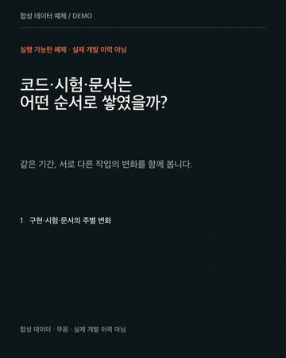

# Data Story Video

**실제 기록을 하나의 질문으로 묶어, 움직이는 차트와 쉬운 설명으로 전달하는 무음 영상 제작 스킬.**

[English](README.en.md) · [제작 스킬](skills/data-story-video/SKILL.md) · [상세 실행 방법](skills/data-story-video/references/rendering.md) · [MIT License](LICENSE)



미리보기와 동봉 CSV는 전부 **합성 데이터**입니다. 실제 프로젝트의 이력이나 성과를 뜻하지 않습니다. [완성 MP4](docs/demo.mp4) · [대본·근거·검증 통합 MD](docs/DEMO.md)

## 무엇을 만드는가

최근 관심 주제·영상 레퍼런스 조사 → 기록·CSV 대조 → 질문 하나 → 익숙한 예시와 용어 풀이 → 실제 데이터의 애니메이션 → 장면별 하단 설명 → 근거에 맞는 인사이트.

- Motion Canvas 차트, Pillow 한글 텍스트, FFmpeg MP4 합성.
- 기본 1080×1350 / 30fps / 무음. 예제 1장은 25초이며, 기준 구성 4장은 76초입니다. 읽을 시간에 맞게 조정합니다.
- 수치·날짜·집계 단위·기술 용어를 유지하며 비전문가도 차트를 읽도록 설명합니다.
- AI 에이전트가 편별 스크립트·기술 설명 초안·근거·검증·독립 MD를 준비하도록 안내합니다.
- 개인 설정, 사내 자료, 계정, API 키, 유료 영상 서비스가 필요 없는 로컬 예제가 포함됩니다.

이 저장소는 **에이전트용 제작법 + 실행 가능한 차트·합성 스타터**입니다. 버튼 하나로 임의의 자료를 분석해 역사적 사실을 검증하는 완성형 SaaS는 아닙니다. 스크립트는 영상을 렌더하고 미디어 규격을 검증하며, 자료 해석과 기술 원고는 에이전트와 사용자가 검토합니다.

## 1. Codex 플러그인으로 설치

플러그인 CLI를 지원하는 Codex에서:

```sh
codex plugin marketplace add jwjinn/video_skill --ref master
codex plugin add data-story-video@video-skill
```

새 대화에서 `data-story-video` 스킬을 선택하거나 다음처럼 요청합니다.

```text
$data-story-video로 첨부한 기록을 설명하는 무음 영상을 만들어줘.
하나의 질문 아래 차트들을 연결하고, 쉬운 예시와 장면별 하단 설명을 넣어줘.
원래 수치와 기술 내용은 유지하고, 대본·근거·기술 설명을 편별 MD에도 모아줘.
```

클라이언트에 따라 스킬이 플러그인 이름과 함께 표시될 수 있습니다. CLI의 `plugin add`가 없는 버전은 marketplace를 추가한 뒤 데스크톱 앱의 플러그인 목록에서 **Video Skill by jwjinn → Data Story Video**를 설치합니다. 목록이 갱신되지 않으면 앱을 재시작합니다.

이것은 GitHub 기반 marketplace 배포입니다. 공식 공용 플러그인 디렉터리에 심사·등록되었다는 뜻은 아닙니다. 계정 로그인·MCP 서버·자동 실행 훅은 포함하지 않습니다.

## 2. 스킬만 직접 설치

플러그인 대신 아래 방법 중 하나만 사용합니다. 기존 같은 이름의 스킬이 있으면 덮어쓰지 말고 먼저 내용을 비교하세요.

```sh
git clone https://github.com/jwjinn/video_skill.git
mkdir -p ~/.agents/skills
cp -R video_skill/skills/data-story-video ~/.agents/skills/data-story-video
```

저장소의 `skills/data-story-video/`는 상대 경로만 사용하는 독립 스킬입니다. 다른 Agent Skills 지원 도구에서도 해당 도구의 스킬 디렉터리에 복사해 사용할 수 있습니다. 도구별 플러그인 설치 호환성을 모두 검증한 것은 아닙니다.

## 3. AI 없이도 예제 렌더 실행

필요한 것: **Python 3.10+, Node.js 20+, npm, FFmpeg·ffprobe, 한글 폰트**.

Ubuntu/Debian은 `sudo apt-get install ffmpeg fonts-noto-cjk`, macOS는 FFmpeg 설치 후 시스템 한글 폰트를 사용할 수 있습니다. 폰트 파일은 재배포하지 않습니다. 다른 폰트는 `VIDEO_FONT_FILE`로 지정합니다.

```sh
git clone https://github.com/jwjinn/video_skill.git
cd video_skill
cp -R skills/data-story-video/assets/his01-starter ./my-video
cd my-video
python3 -m venv .venv
. .venv/bin/activate
python3 -m pip install -r requirements.txt
cd motion-canvas
npm ci
npx playwright install chromium
npm run check
npm run render
cd ..
python3 render.py --redraw
```

Linux의 브라우저 시스템 라이브러리가 없으면 `npx playwright install --with-deps chromium`을 사용합니다. Windows에서는 가상환경 활성화 명령을 `.venv\Scripts\activate`로 바꿉니다.

결과: `my-video/output/DEMO.mp4`와 `DEMO-validation.json`. 초회 의존성 설치에는 인터넷 연결이 필요하며, 렌더는 로컬에서 실행됩니다.

## 제작 전에 레퍼런스 조사

새 영상은 대상 채널의 최근 논점과 실제 영상·이미지를 먼저 조사합니다. 시청자가 궁금해하는 질문을 찾고, 본인 기록으로 뒷받침할 수 있는 주제를 골라 대본과 장면에 연결합니다. LinkedIn과 Instagram의 관심사·표현 방식은 따로 봅니다.

원문 URL·게시일·조사일·실제로 확인한 영상 구간·적용 이유를 기록하고, 결과를 `00-사전리서치/`와 편별 통합 MD에 남깁니다. 색상 같은 작은 수정은 기존 조사를 재사용합니다. 외부 트렌드는 소재와 표현을 고르는 참고이며, 본인의 개발 사실은 원천 기록으로 입증합니다.

[사전 리서치 절차](skills/data-story-video/references/preproduction-research.md)

## 내 자료로 바꾸기

|파일|역할|
|---|---|
|`episode.json`|질문·제목·예시·하단 설명·결말·장면 길이|
|`chart-catalog.json`|차트 제목과 출처|
|`motion-canvas/data/sample.csv`|예제의 주별 구현·시험·문서 줄 수|
|`motion-canvas/src/scene.ts`|차트 모양, 애니메이션, 축과 범례|
|`layout.py`|문구 배치, 색, 폰트|
|`render.py`|차트 합성, 출력, 프레임·무음·디코드 검증|

실제 데이터로 교체할 때 합성 표기를 지우는 것만으로 끝내지 않고, 영상의 모든 수치·단위·설명·주장을 원천에 대조합니다. 코드량은 품질·생산성 점수가 아니고, API 단가로 환산한 비용은 실제 청구액과 다릅니다. 자세한 입력·crop·폰트 계약은 [rendering.md](skills/data-story-video/references/rendering.md)에 있습니다.

## 검증과 라이선스

`python3 scripts/check_package.py`는 배포 구조, 상대 경로, 개인 경로 누출 여부, 예제 데이터와 Python 구문을 검사합니다. [GitHub Actions](.github/workflows/verify.yml)는 예제를 타입 검사·렌더·디코드합니다. 수치 해석의 정확성은 별도로 확인해야 합니다.

이 저장소의 코드와 문서는 MIT입니다. 외부 도구·폰트는 각각의 라이선스를 따릅니다. [외부 의존성 안내](THIRD_PARTY.md)를 확인하세요.

플러그인 형식과 marketplace 설치는 [OpenAI 공식 문서](https://developers.openai.com/plugins/build/plugins)를 기준으로 구성했습니다.
